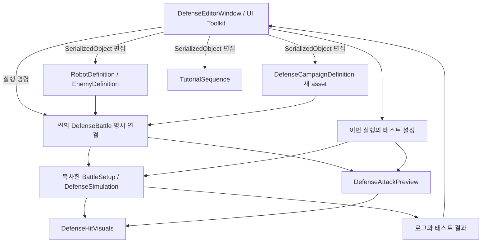

# CodingGame 통합 개발 에디터 구현 아키텍처

작성일: 2026-10-08  
상태: 구현. 사용법과 실행 범위는 [EditorUsage.md](EditorUsage.md)를 참고한다.

## 1. 목표와 범위

Unity 메뉴 `CodingGame > 개발 에디터`에서 밸런스 편집, 테스트 설정, 전투 조작, 튜토리얼 작성, 블록 코드 확인, 이펙트 비교, 검증 결과를 관리한다. 여기서 에디터는 플레이어용 블록 개발 툴과 구분되는 **Unity EditorWindow**다.

현재 게임에 있는 기능과 반복적으로 확인하는 회귀 문제를 관리 대상으로 삼는다. 게임의 공격·보급·진행 계산은 기존 런타임 코드를 호출한다. 에디터에 별도 전투 계산기를 만들지 않는다.

핵심 원칙:

- **밸런스 원본 편집**과 **이번 플레이에만 적용하는 테스트 설정**을 화면에서 구분한다.
- 항목마다 `원본`, `현재 적용값`, `적용 시점`을 표시한다.
- Game View의 실제 UI, 씬, 프리팹을 유지한다. 에디터는 이 구조를 조작하고 검사한다.
- 전투와 미리보기는 `DefenseSimulation`, `DefenseProgram`, `DefenseHitVisuals`를 공유한다.
- 테스트 토글의 기본값은 정상 게임 동작이다. 테스트 조건이 적용된 결과에는 해당 조건을 기록한다.

## 2. 현재 코드에서 확인한 구조

| 현재 위치 | 담당 내용 | 에디터화 시 처리 |
|---|---|---|
| `RobotDefinition`, `EnemyDefinition` | 이름, 설명, 스탯, 프리팹 | 기존 `.asset` 직접 편집 |
| `DefenseBattle` 직렬화 필드 | 기본 웨이브, 경로 참조, 배치 영역, 기지 체력, 설치 제한, 진행 설정 | 콘텐츠 수치는 캠페인 asset으로 이동, 씬 참조는 유지 |
| `DefenseSimulation.ScaledWave()` | 같은 기본 웨이브를 스테이지별로 성장시킴 | 성장 계수를 데이터화하고 최종 적용값 표시 |
| `DefenseProgression`, `DefenseCurriculum` | 초기 재화, 준비 보급, 보상, 5스테이지 × 5웨이브 학습 내용 | 기존 데이터를 보존해 캠페인 asset으로 이관 |
| `DefenseSimulation` | 전투, 배치, 공격 횟수 제한, 보상, 스테이지 진행 | 공용 실행 로직 유지, 필요한 테스트 제어만 추가 |
| `RobotState` | 최고 레벨 2, 강화 배율 1.2 상수 | 밸런스 규칙으로 이동 |
| `DefenseInventoryUI` | 개별 지급, 각 로봇 +10 / 모든 블록 +50 | 지급 처리를 공용 메서드로 분리하여 재사용 |
| `TutorialSequence` | 진입 조건, 대사, 타이핑 속도, step 위치, 행동 조건 | 기존 asset 편집 UI와 테스트 제어 추가 |
| `TutorialInputBridge` | target key와 UI/월드 대상 연결 | 연결 검사와 대상 표시 기능 추가 |
| `CommandCodingPanel`, `PythonTreeCompiler` | 블록 편집, 스냅, Undo/Redo, 코드 생성 | 기존 Game View 편집기와 결과를 연결 |
| `DefenseAttackPreview`, `DefenseHitVisuals` | 미리보기, 발사·피격·근접 이펙트 | 테스트 토글과 상태 표시 연결 |
| `Tests/Defense`, `Tests/BlockCoding`, `Tests/Unity` | 콘솔 실행 검사와 Unity 실행 검사 혼재 | 실행 조건을 명시하고 기존 검사부터 연결 |

주의할 현재 동작:

1. 반복문 해금은 현재 인벤토리에 `For` 또는 `While` 키가 존재하는지로 판단한다. 에디터에는 현재 판정과 이유를 표시한다. 로봇별 해금 정책으로 바꾸는 작업은 별도 게임 규칙 변경이다.
2. 반복문 해금 전 공격 제한은 `floor(stage × 5.25 + 0.5)`다. 성공한 비버프 행동이 횟수를 소비한다.
3. 원거리 피해는 현재 `기본 행동 피해 × 기본 사거리 / max(1, 실제 거리)`다. 단순히 기본 피해가 최대 피해인 공식은 아니다. 거리별 계산값을 이 공식 그대로 보여준다.
4. `MakeSetup()`은 진행 설정을 참조로 넘기며, 다른 설정 일부는 복사한다. 테스트 원본 보호를 위해 설정 복사 경계를 통일해야 한다.
5. `DefenseBattle`과 미리보기는 소비한 `Events` 목록을 비운다. 로그 창에서 나중에 목록을 읽으면 이벤트를 놓칠 수 있다.
6. 기존 Unity 검사 중에는 `IRunCommand`, `run_script` 등 외부 실행기를 전제로 한 파일이 있다. 모두 Unity Test Runner에서 바로 실행 가능한 상태는 아니다.
7. 학습 항목(`Lesson`)이 있는 웨이브는 현재 처치 블록 드롭 없이 지정 종료 보상을 지급한다. `NeededDrop()`은 학습 항목이 없는 전투에서 사용된다. 에디터는 적용 중인 정책을 표시하고, 드롭 ON만으로 기존 학습 웨이브에 추가 보상을 만들지 않는다.

## 3. 에디터에 넣을 요소 목록

표의 상태는 현재 게임 구현을 기준으로 한다. 모든 항목은 최종 에디터 범위에 포함하며, 구현 순서는 10절에 정한다.

| 탭 | 요소 | 현재 기반 / 추가할 부분 | 적용 시점 |
|---|---|---|---|
| 세션 | 대상 `DefenseBattle`, 캠페인, 현재 stage-wave, 전투 상태 | 기존 대상 명시 선택, 연결 상태 표시 추가 | 즉시 표시 |
| 세션 | 시작, 일시정지, 재개, 1/2배속, 재시작 | 기존 전투 메서드 재사용 | Play Mode |
| 세션 | 한 틱 진행, stage-wave 지정 시작, 같은 조건 재실행 | 명시적인 테스트 시작 API 추가 | 세션 재생성 / 일시정지 중 |
| 세션 | 정상 진행 / 단독 웨이브 테스트 구분 | 시작 조건과 보급 누적 정책 추가 | 시작 전 |
| 밸런스 | 로봇 공통: 피해, 사거리, 주기, 반경, 체력 | `RobotSpec` | 새 세션 |
| 밸런스 | 전사: 180도 범위와 피해 표시 | 기존 판정 재사용, 범위 시각 비교 | 표시 즉시 |
| 밸런스 | 탱커: 저지 반경·수, 체력, 스턴 지속 | `RobotSpec` | 새 세션 |
| 밸런스 | 폭탄: 투사체 속도, 폭발 반경 | `RobotSpec` | 새 세션 |
| 밸런스 | 유틸: 감속 비율·지속시간 | `RobotSpec` | 새 세션 |
| 밸런스 | 버퍼: 피해·사거리·공격주기 배율 | `RobotSpec` | 새 세션 |
| 밸런스 | 적 종류별 체력, 속도, 공격력, 공격주기, 누수 피해 | `EnemySpec` | 새 세션 |
| 밸런스 | 기지 체력, 전체/역할별 설치 제한, 강화 비용·상한·배율 | 기존 필드와 상수 데이터화 | 새 세션 |
| 밸런스 | 공격 횟수 계수, 역할별 행동 호환표 | 기존 규칙 데이터화, 판정 결과 표시 | 새 세션 |
| 밸런스 | 실제 거리별 원거리 피해, 공격주기 기준 DPS | 기존 함수로 계산, 계산 조건 병기 | 편집 즉시 |
| 캠페인 | 스테이지 1~5, 각 웨이브 1~5 선택 | 25개 항목 목록 추가 | 원본 편집 |
| 캠페인 | 적 종류, 수량, 경로, 등장 지연·간격 | 기존 `SpawnEntry` 재사용 | 새 세션 |
| 캠페인 | 성장 계수·종류 배율·속도 상한·웨이브 제한시간 | 코드에 있는 계수 데이터화 | 새 세션 |
| 캠페인 | 기본값과 배율 적용 후 체력·속도 비교 | `ScaledWave`와 같은 계산 경로 | 편집 즉시 |
| 캠페인 | 다음 웨이브 예고, 좌우 경로 배정, 잔존 적 이월 | 실제 스폰 계획·결과 표시 | Play Mode |
| 보급·해금 | 초기 코인·로봇·블록, 처치 코인 | `DefenseProgression` | 새 세션 |
| 보급·해금 | 웨이브별 학습 내용, 준비 보급, 종료 보상 | `WaveLesson` | 새 세션 |
| 보급·해금 | 필요 블록 드롭 정책과 현재 후보·선택 이유 | `NeededDrop()` 진단 정보 추가 | Play Mode |
| 보급·해금 | 로봇·블록 해금, 보유·사용·잔여 수량 | 기존 인벤토리 읽기 | 즉시 표시 |
| 보급·해금 | 선택 아이템 추가, 전체 추가, 테스트 재화 설정 | 기존 지급 API 재사용, 재화 설정 API 추가 | Play Mode |
| 테스트 ON/OFF | 전투·표시·학습 기능별 토글 | 4절의 의미로 구현 | 항목별 명시 |
| 튜토리얼 | 시퀀스·step 목록, 순서, 대사, 화자·초상화 | `TutorialSequence` | 원본 편집 |
| 튜토리얼 | stage-wave, Entry Phase, 활성화, 초당 글자 수 1~20 | 기존 필드 | 새 시퀀스 실행 |
| 튜토리얼 | 위/아래 위치, 음영 여백, target keys, 완료 조건 | 기존 필드와 대상 선택 UI | 새 시퀀스 실행 |
| 튜토리얼 | 현재 step, 기다리는 행동·신호, 대상 연결 상태 | 공개 읽기 상태 추가 | Play Mode |
| 튜토리얼 | 재실행, 특정 step 테스트, 이전/다음, 타이핑 즉시 완료 | 정식 테스트 API 추가 | Play Mode |
| 튜토리얼 | 대화창/목표 영역 겹침, 목표 클릭 차단 표시 | UI 레이캐스트·월드 투영 검사 | Play Mode |
| 블록·미리보기 | 선택 로봇, 블록 트리, 생성 코드, 오류 | 기존 편집기·컴파일러 재사용 | Play Mode |
| 블록·미리보기 | 실행 결과, 공격 횟수, 함수 반복 수, 대기 시간, 명령 예산 | `DefenseProgram` 상태 읽기 | Play Mode |
| 블록·미리보기 | 기존 블록 개발 툴 열기, 적용, Undo/Redo | 기존 UI 기능 호출 | 준비 단계 |
| 블록·미리보기 | 코드 수정 중 적 이동 유지, 이펙트/피격 범위 비교 | 기존 미리보기와 전투 시각화 재사용 | Play Mode |
| 블록·미리보기 | 스냅 후보·실제 블록 경계·클릭 영역 표시 | Editor 진단 표시 추가 | Play Mode |
| 진단·검증 | 전투 이벤트, 행동 실패 이유, 보급·보상·배치 실패 로그 | 기존 이벤트와 상태를 수집 | Play Mode |
| 진단·검증 | 로봇/적 ID별 피해, 처치, 누수, 생존 체력, 완료 시간 | 이벤트 집계 추가 | 실행 중 / 종료 |
| 진단·검증 | 참조 누락, 중복 ID, 빈 웨이브, 잘못된 수치 검사 | 기존 `Validate()` 재사용 | Edit Mode |
| 진단·검증 | 단일/선택 검사 실행, 캠페인 1~5 순회, 중단, 결과 저장 | 기존 테스트 로직 연결 | 검사 종류별 구분 |

## 4. ON/OFF 동작 정의

`켜기/끄기`는 단순히 GameObject를 비활성화하는 방식으로 구현하지 않는다. 해당 기능의 계산 또는 표시 지점에서 의미를 정의한다.

| 설정 | 정상값 | OFF 또는 테스트값의 의미 | 적용 |
|---|---|---|---|
| 튜토리얼 실행 | ON | 현재 안내를 정상 종료하고 음영·입력 제한을 함께 해제 | 즉시. 다시 ON은 다음 진입부터, 재실행은 별도 버튼 |
| 튜토리얼 입력 제한 | ON | 안내는 유지하고 일반 입력을 허용 | 즉시, 테스트 전용 |
| 로봇 코드 실행 | ON | 프로그램 상태를 보존하고 새 명령 실행을 정지 | 다음 시뮬레이션 틱 |
| 적 이동 | ON | 위치 이동만 중지, 스폰·공격은 별도 설정을 따름 | 다음 틱 |
| 적 공격 | ON | 새 적 공격을 정지 | 다음 틱 |
| 적 스폰 | ON | 스폰 시계를 정지. 다시 켤 때 밀린 수량을 한꺼번에 생성하지 않음 | 다음 틱 |
| 기지 피해 | ON | 누수는 기록하고 기지 체력 감소만 막음 | 다음 틱 |
| 로봇 피해 | ON | 피해 요청은 기록하고 로봇 체력 감소만 막음 | 다음 틱 |
| 로봇 공격 피해 | ON | 행동·쿨다운·이펙트는 발생하고 적 체력 감소만 막음 | 다음 틱 |
| 웨이브 시간 제한 | ON | 시간 초과 종료와 이월을 끄고 적 소진으로만 종료 | 테스트 시작 시 |
| 공격 횟수 제한 | ON | 반복문 해금 상태와 관계없이 횟수 제한만 해제 | 다음 틱, 누적 횟수 유지 |
| 설치 개수 제한 | ON | 전체·역할별 개수 제한만 해제, 금지 지형·겹침 검사는 유지 | 다음 배치 요청 |
| 인벤토리 제한 | ON | 수량 부족 검사만 우회, 해금 상태는 유지 | 다음 편집·배치 요청 |
| 전체 해금 | OFF | 잠긴 로봇·블록도 선택 가능. 수량 무제한과 별개 | 다음 목록 갱신 |
| 준비 보급 / 종료 보상 / 처치 드롭 | 각각 ON | 해당 지급만 건너뜀. 다시 ON으로 과거 보상을 중복 지급하지 않음 | 해당 단계 진입 / 처치 시 |
| 사거리 / 피격 범위 표시 | 기존 기본값 | 표시만 변경 | 즉시 |
| 발사 / 피격 / 슬래시 VFX | ON | 해당 시각 효과만 숨김. 이미 생성한 효과도 정리 | 즉시 |
| 투사체 표시 | ON | 표시만 숨김. 투사체 도달 시점과 피해 계산 유지 | 즉시 |
| 미리보기 실행 | ON | 미리보기 시간을 정지. 다시 켜면 같은 상태에서 재개 | 즉시 |
| 상세 이벤트 기록 | OFF | 상세 로그 수집 중지, Unity 오류는 계속 표시 | 즉시 |

스폰 OFF 상태에서는 미등장 적을 남은 적 수에 포함해 웨이브 조기 완료를 막는다. 피해 OFF에서 생긴 로그는 실제 피해와 요청 피해를 구분한다. 공격 횟수 제한을 다시 ON으로 바꾸면 이미 누적한 횟수에 정상 상한을 적용한다.

`정상값 복원`은 테스트 설정만 초기화한다. 체력·적 위치·보상 수령 상태를 과거로 돌리지 않는다. 완전 초기화는 `같은 조건으로 재시작`으로 제공한다.

## 5. 화면 구조

```text
CodingGame 개발 에디터
├─ 상단: 현재 씬·연결된 캠페인 (자동) | Edit/Play 상태 | 설정 검사
├─ 왼쪽: 세션 / 밸런스 / 캠페인 / 보급·해금 /
│        테스트 ON/OFF / 튜토리얼 / 블록·미리보기 / 진단·검증
├─ 중앙: 목록 + 선택 항목 상세 편집
├─ 하단 상태: 원본 수정 여부 | 적용 시점 | 테스트 조건 적용 중
└─ 실행 바: 테스트 시작 / 정지 / 한 틱 / 재시작 / 결과 저장
```

UI Toolkit의 `EditorWindow.CreateGUI`, `PropertyField`, `ListView`, `ScrollView`를 사용한다. 원본 필드는 `SerializedObject`에 바인딩하여 Unity Undo/Redo와 Inspector를 함께 지원한다. 새로운 노드 편집기나 별도 블록 캔버스는 만들지 않는다.

실행 상태는 약 5Hz로 갱신하며, 입력이나 상태 변경 시에는 즉시 갱신한다. 창을 닫거나 Play Mode가 종료되면 이벤트 구독과 갱신 작업을 해제한다.

## 6. 데이터와 실행 구조



### 6.1 저장할 데이터

| 데이터 | 저장 위치 | 내용 |
|---|---|---|
| 로봇·적 정의 | 기존 `.asset` | 기존 참조와 GUID 유지 |
| 캠페인 정의 | 신규 `DefenseCampaignDefinition.asset` | 공통 규칙, 스테이지별 웨이브, 보급·보상 |
| 튜토리얼 | 기존 `TutorialSequence.asset` | 현재 형식 유지 |
| 공유 테스트 조건 | `DefenseTestScenario.asset` | 시작 stage-wave, 초기 배치·코드·재화, 선택 토글, 실행 제한시간 |
| 창 선택·접힘 상태 | `SessionState` | 게임 설정에 포함하지 않는 편집 편의 상태 |
| 현재 실행 상태 | 메모리 | Play 종료 시 폐기 |
| 실행 보고서 | `TestResults/Editor/`의 JSON | 설정 snapshot, 실행 조건, 결과, 실패 원인 |

테스트 시나리오는 반복 재현이 필요한 조건만 저장한다. 매번 임시 조작을 자동으로 asset에 저장하지 않는다. JSON 결과에는 원본 경로/GUID와 실제 사용한 수치 snapshot을 함께 넣는다.

### 6.2 캠페인 설정

새 asset 하나에 다음을 포함한다.

- 공통 규칙: 기지 체력, 설치 제한, 역할별 제한, 강화, 공격 횟수 계수, 행동 호환표, 적 성장 계수.
- 기존 `DefenseProgression`: 초기 재화·아이템, `WaveLesson`, 드롭 설정.
- 스테이지 목록: 번호, 각 웨이브의 `SpawnEntry[]`, 제한시간.
- 기존 로봇·적 정의 참조 목록.

경로 Transform, Collider, 카메라, HUD, VFX 참조는 씬/프리팹에 남긴다. asset에 씬 오브젝트 참조를 저장하지 않는다. 웨이브의 경로 번호는 선택된 전투 씬의 경로 목록에 대해 검사한다.

현재 5개 기본 웨이브는 이관 시 각 스테이지의 초기값으로 복사한다. 적 성장식은 실행 계획을 만들 때 한 번만 적용한다. asset에는 기본 수치, 화면에는 기본/최종 수치를 함께 표시하여 이중 배율 적용을 막는다.

`DefenseCurriculum.Create()`는 신규 콘텐츠의 초기 템플릿 용도로만 사용한다. asset에 저장된 편집 내용을 실행 때 다시 기본 커리큘럼으로 덮어쓰지 않는다. 스테이지 수와 진행 가능 여부도 캠페인 목록을 기준으로 바꾼다.

### 6.3 런타임 경계

- `DefenseBattle.MakeSetup()`에서 asset을 읽고 `BattleSetup`의 깊은 복사본을 만든다. 진행 목록·배열·스탯도 복사한다.
- `DefenseSimulation`은 UnityEditor에 의존하지 않는 순수 C# 상태를 유지한다.
- 테스트 옵션은 명시적인 `DefenseTestOptions` 값으로 전달한다. 모든 기본값은 정상 동작이다.
- 편집기 전용 조작 진입점은 `#if UNITY_EDITOR`로 제한한다. 에디터 창이 없거나 옵션이 전달되지 않은 실행은 정상 게임과 같아야 한다.
- `DefenseBattle`의 게임 규칙·HUD 동기화 경로를 재사용한다. 에디터가 `Simulation` 상태만 수정하고 화면을 방치하는 경로를 만들지 않는다.
- Editor 코드에서 활성 씬의 유일한 전투를 읽고 해당 전투의 캠페인 asset을 자동으로 선택한다. 수동 선택 필드는 제거한다. 런타임 구조나 Inspector 연결은 변경하지 않는다. 캠페인 asset은 스테이지·웨이브·보급·규칙의 영구 저장을 위해 유지한다.
- 테스트 코드에서 사용한 private reflection 호출을 제품 에디터의 API로 채택하지 않는다.

## 7. 추가·수정할 코드 책임

아래 이름은 구현 시 사용할 제안이다. 별도 서비스 계층·인터페이스·등록 프레임워크는 필요하지 않다.

| 파일 / 영역 | 책임 |
|---|---|
| `Assets/!_Project/Editor/Defense/DefenseEditorWindow.cs` | 창 진입점, 명시적 대상 연결, 탭 구성, 상태 갱신·해제 |
| `DefenseEditorWindow.uxml`, `.uss` | Unity Editor용 레이아웃·스타일 |
| `DefenseContentPanel.cs` | 로봇·적·캠페인·보급의 SerializedProperty 편집과 검사 |
| `DefensePlayPanel.cs` | 세션 명령, 테스트 토글, 인벤토리 지급, 실시간 상태 |
| `DefenseTutorialPanel.cs` | 시퀀스 편집, 대상 연결·겹침 검사, 현재 대기 조건 |
| `DefenseDiagnosticsPanel.cs` | 이벤트 목록, 지표, 검사 실행·중단·결과 저장 |
| `DefenseCampaignDefinition.cs` | 공유 콘텐츠 asset. 런타임 영역에 배치 |
| `DefenseTestScenario.cs` | 테스트 재현 asset. Editor 영역에 배치 |
| `DefenseModels.cs` / `DefenseProgression.cs` | 데이터화된 규칙, 테스트 옵션, 복사 및 수치 검증 |
| `DefenseBattle.cs` | 원본 설정 변환, 공용 지급·테스트 세션 제어, HUD 동기화 |
| `DefenseSimulation.cs` | 옵션 적용, 지정 단계 테스트 초기화, 공용 수치 계산 |
| `TutorialDirector.cs` | 읽기 전용 현재 상태, 정상 종료·재실행·step 테스트 API |
| `DefenseHitVisuals.cs` / `DefenseAttackPreview.cs` | 표시 토글과 미리보기 정지·재개 |

공용 지급은 `GrantRobot`, `GrantBlock`을 사용한다. 전체 지급의 수량 사전 검사는 기존처럼 전부 성공 가능한지 확인한 뒤 한 번에 적용한다. 에디터 버튼을 누르려고 `DefenseInventoryUI`의 TMP 입력칸을 채우는 방식은 사용하지 않는다.

## 8. 적용·저장·테스트의 세부 흐름

### 8.1 원본 밸런스 편집

1. Edit Mode에서 원본 asset을 선택한다.
2. SerializedProperty로 수정한다. 유효 범위와 기존 `Validate()` 결과를 바로 표시한다.
3. 저장 시 수정한 asset만 저장한다. 씬 참조 수정은 별도 씬 저장으로 표시한다.
4. 다음 실행은 저장된 값의 복사본을 사용한다.

Play Mode에서는 복사본을 편집하고 `적용`으로 런타임에 반영한다. 체력은 최대치로 초기화하고 투사체를 제거한다. 전투 진행·보상 수령 상태는 유지한다. `수치 적용 확정`은 적용 후 원본 asset까지 저장한다. 현재 스폰 항목 추가·삭제·경로 변경은 재시작을 요구한다.

테스트 값을 원본에 반영하려면 Play 종료 후 값별 차이를 확인하고 저장한다. 테스트 종료만으로 원본이 변경되지 않는다.

### 8.2 지정 stage-wave 시작

테스트 시작은 두 모드로 구분한다.

- **캠페인 진행 검사:** 1-1부터 정상 게임의 보급·보상·진행 메서드를 호출하여 도달한다. 중간 상태와 이월을 포함해 검증한다.
- **단독 웨이브 검사:** 해당 stage-wave에서 새 세션을 만든다. 시나리오가 초기 인벤토리·배치·코드·체력을 명시한다. 이전 웨이브의 생존 적과 사용 자원은 추측하지 않는다.

편의 옵션 `이전스테이지까지의 보상`은 이전 스테이지의 준비 보급과 종료 보상을 합산한다. 현재 스테이지의 지난 웨이브·과거 처치 코인·자원 사용량은 재현하지 않는다.

새 세션을 만들 때 로봇·적·투사체·이펙트·튜토리얼·미리보기 상태를 함께 정리한다. `Stage`나 `WaveIndex` 필드만 바꾸는 점프는 금지한다.

### 8.3 튜토리얼 테스트

- 시퀀스의 런타임 복사본으로 실행한다. 원본의 `enabled`와 대사를 임시로 덮어쓰지 않는다.
- 중간 step 테스트는 목표가 이미 존재하는 시나리오에서만 허용한다. 배치 로봇 등 선행 조건이 없으면 누락 조건을 표시한다.
- 튜토리얼 OFF는 `Finish`에 해당하는 정상 정리 경로를 사용한다. 컴포넌트만 꺼서 클릭 차단막을 남기지 않는다.
- 이전/다음은 게임에서 사용하는 대사 이동 경로를 호출한다. 재방문 시 타이핑을 반복하지 않는 규칙도 유지한다.
- UI 목표는 `EventSystem.RaycastAll` 결과, 월드 목표는 투영 영역과 입력 허용 여부로 검사한다. 대화 패널에 가려진 목표를 목록에 표시하고 해당 step의 위/아래 설정으로 이동한다.
- 플레이어가 로봇을 배치한 위치에 따라 겹침은 달라질 수 있다. 한 위치에서 성공했다고 모든 배치에서 통과로 기록하지 않는다.

### 8.4 이벤트와 로그

전투 이벤트 소비 루프에서 **목록을 비우기 전에** 에디터 관찰자에게 이벤트 값을 전달한다. 에디터는 목록 소유권을 가져오거나 먼저 비우지 않는다. 미리보기 로그에는 별도 출처를 붙인다.

행동 실패는 `ActionResult`, 프로그램 오류는 `DefenseProgram.Fault`를 활용한다. `CoolingDown`처럼 매 틱 반복되는 결과는 상태 변경 시 기록하거나 횟수를 집계한다. 로그는 최근 1,000개만 메모리에 유지하고 오래된 항목부터 제거한다.

로그 필드: 실행 ID, stage-wave, 시뮬레이션 시간, 본게임/미리보기, 종류, 로봇·적 ID, 피해/수량, 실패 이유. 표시용 문자열만 남기지 않고 결과 저장에 필요한 숫자를 유지한다.

### 8.5 재현성

같은 입력, 복사한 설정, 고정 틱으로 실행한다. 드롭은 정해진 정책을 사용하므로 사용하지 않던 seed 설정을 제거한다. 렌더링 VFX 모양까지 완전히 같다는 보장은 하지 않는다.

## 9. 기존 데이터 이관

1. 현재 씬의 콘텐츠 값, 로봇·적 참조, 25개 학습 항목을 읽는다.
2. 신규 캠페인 asset을 만들고 현재 값과 성장 계수를 그대로 복사한다. 이 단계에서 밸런스를 조정하지 않는다.
3. 이관 전/후 생성한 25개 최종 스폰 계획, 보급·보상, 공격 제한을 비교한다.
4. Undo 가능한 명시적 이관 버튼으로 선택한 `DefenseBattle`의 캠페인 참조를 연결한다.
5. 연결과 결과가 확인되면 중복된 콘텐츠 직렬화 필드를 제거한다. 누락된 참조는 오류로 알린다.

이관은 사용자가 요청한 에디터 기능의 일부로 구현한다. 에디터 창을 여는 것만으로 씬·asset을 수정하거나 자동 이관하지 않는다. 기존 authored HUD, 경로, 카메라, 프리팹 구조는 유지한다.

## 10. 구현 순서와 완료 기준

| 단계 | 구현 | 완료 기준 |
|---|---|---|
| 1. 창과 원본 편집 | UI Toolkit 창, 전투 대상 선택, 기존 로봇·적·튜토리얼 asset 바인딩 | Inspector와 값 일치, Undo/Redo, 누락 참조 표시 |
| 2. 캠페인·밸런스 데이터 | 캠페인 asset, 규칙 데이터화, 명시적 이관 | 이관 전후 25웨이브 수치·보급 일치, 컴파일 오류 없음 |
| 3. 세션·지급 | 지정 조건 시작, 재시작, 정지, 한 틱, 개별/전체 지급 | 중복 지급 방지, 초기화 후 잔류 오브젝트 없음 |
| 4. ON/OFF | 4절의 옵션, 정상값 복원, 적용 시점 표시 | 각각 단독 전환과 조합 확인, Play 종료 후 원본 불변 |
| 5. 튜토리얼·블록·VFX | step 테스트, 겹침·스냅 진단, 기존 개발 툴·미리보기 연결 | 안내 대상 클릭 가능, 코드 수정 중 적 이동 유지, 전투/미리보기 동일 효과 |
| 6. 로그·회귀 검사 | 관찰 이벤트, 지표, 기존 테스트 연결, JSON 보고서 | 정상/실패/중단 구분, 시간 제한, 콘솔 오류 및 참조 확인 |

각 단계는 앞 단계의 데이터와 공용 API를 사용한다. 데이터 구조가 확정되기 전에 토글마다 새로운 별도 매니저를 추가하지 않는다.

## 11. 검증 계획

구현 과정에서 실행할 검사다. 이번 설계 작업에서 새 테스트를 실행했다는 의미는 아니다.

- 원본 asset 편집 Undo/Redo, 저장 후 재로드, 누락 연결 검사.
- 5스테이지 × 5웨이브의 이관 전후 설정 비교.
- 실제 거리별 원거리 피해, 전사 반원 동일 피해, 탱커 웨이브 간 체력 유지.
- 해금 전 공격 횟수 반올림, 해금 후 제한 해제, 토글 복원 시 누적 횟수 유지.
- `전체 추가`를 두 번 누르면 로봇 각각 +20, 블록 각각 +100인지 확인. 정수 오버플로 시 부분 지급 없음.
- 스폰 정지·재개 시 몰아서 등장하거나 웨이브가 잘못 종료되지 않는지 확인.
- 원본 `TutorialSequence`가 비활성인 상태에서도 복제 테스트 가능하며, 종료 후 원본이 그대로인지 확인.
- 튜토리얼 상단/하단, 이전 대사, 닫기, 배치·개발·전투 시작 목표를 실제 UI 입력 경로로 확인.
- VFX OFF 상태에서도 피해와 투사체 도달 시간이 유지되는지 확인.
- 한 틱 진행에서 자동 Update와 이중으로 전투가 진행되지 않는지 확인.
- 로그 수집 ON/OFF가 전투 결과와 VFX 이벤트 소비에 영향을 주지 않는지 확인.
- Domain Reload 설정 ON/OFF, 창 재열기, Play 반복에서 중복 구독·이전 세션 참조가 없는지 확인.
- Editor 전용 코드가 플레이어 빌드에 포함되지 않고 정상 기본값으로 실행되는지 확인.

순수 로직 검사는 기존 `Tests/Defense/Defense.Check.csproj`, `Tests/BlockCoding/BlockCoding.Check.csproj`를 우선 재사용한다. Unity 검사는 기존 파일에서 검증 본문을 재사용하되, 외부 실행기 전제와 씬 재생 조건을 정리한 뒤 창에 연결한다. 임의 `.cs` 파일을 선택해 실행하는 범용 스크립트 실행기는 만들지 않는다.

테스트 결과는 `통과 / 실패 / 중단 / 선행 조건 미충족`으로 구분한다. 자동 배치 시뮬레이션 통과와 실제 클릭·드래그 UI 통과를 별도로 기록한다.

## 12. 첫 사용 흐름

1. `CodingGame > 개발 에디터`를 연다.
2. 씬의 `DefenseBattle`과 캠페인을 선택한다.
3. 밸런스 또는 보급 내용을 편집하고 저장한다.
4. 테스트할 stage-wave와 초기 조건을 선택한다.
5. Play Mode에서 전투·튜토리얼·블록 동작을 확인한다.
6. 필요한 ON/OFF를 적용하고 실패 이유와 지표를 확인한다.
7. 같은 조건으로 재실행하거나 시나리오·결과를 저장한다.

**최종 완료 정의:** 위 기능 목록이 통합 창에서 접근 가능하고, 원본 편집과 임시 테스트가 구분되며, 같은 게임 로직으로 실행되고, 테스트 종료 후 원본과 authored 구조가 보존되는 상태.
