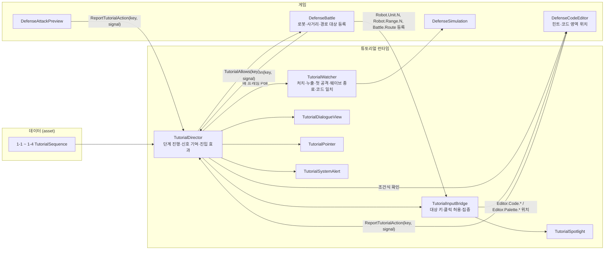

# 튜토리얼 구현 아키텍처 (Stage 1-1 ~ 1-4)

| 항목 | 내용 |
|---|---|
| 작성일 | 2026-10-14 (2026-10-15 기획 답·1-4 수정본·사용자 결정 반영) |
| 사양 | [튜토리얼_명세서.md](튜토리얼_명세서.md) |
| 대본 | [flow_stage1/tutorial_stage1_대본.md](flow_stage1/tutorial_stage1_대본.md) |
| 진행 상황 | [튜토리얼_인계서.md](튜토리얼_인계서.md) |

**이번 범위**: 기획 답(P1·P2·P3·P19), 1-4 수정본, 2026-10-15 사용자 결정(집중·화살표, 두 단계 행동, 1-4 두 번째 로봇, 커리큘럼)을 반영했다. 남은 사용자 결정(명세서 §9)에 갈리는 곳은 §8 보류 작업으로 둔다.

## 1. 방향

- **UI는 그대로 쓴다**: 대화창, 스포트라이트(어둡게·테두리·클릭 제한), 입력 브리지, 부팅/경고 오버레이.
- **진행 경로를 하나로 합친다**: Stage 1 전용 `StageOneTutorial`(섹션·줄 번호를 코드에 박아 둔 클래스)을 지우고, 범용 `TutorialDirector` + `TutorialSequence` asset(웨이브마다 하나)으로 만든다.
- 대사·발화자·대상·집중·완료 조건·진입 효과는 asset에서 입력하고, 코드는 "신호가 오면 다음 단계"만 한다.
- 옛 학습 규칙(`damage`/`range` 변수가 스탯을 바꾸는 규칙, `Attack()` 표기 파서)과 옛 대사는 지운다.

## 2. 구성

## 3. 결정된 규칙과 구현 위치

| 규칙 | 구현 | 상태 |
|---|---|---|
| 함수 5회(반복문 해금 후 1회), 공격 한도 없음 | `DefenseSimulation.FunctionRepeatLimit` | 완료 |
| 사거리 안에 적이 들어와야 실행 시작(기획 확인) | `DefenseProgram.Tick` | 완료(옛 `StageOneLearning` 예외 삭제) |
| 웨이브 사이 로봇·코드 유지, 실행 횟수만 초기화 | `ClaimRewards` → `ResetPrograms` | 기존 |
| 1-1~1-3 적 2마리, 1-4 적 4마리(정답 코드로 다 막음) | `StageOneCampaign.asset` | 완료(시뮬레이션·Play Mode 확인) |
| 웨이브별 지급(명세서 §2-1), 주제 문구 | `StageOneCampaign.asset` `lessons` | 완료 |
| 1-1·1-2 회수 잠금 | `DefenseSimulation.RecallUnlocked`, 회수 버튼 비활성, `DefenseBattle` 안내 문구 | 완료 |
| 미리보기 무제한·사거리 원·때릴 적 없으면 1초 뒤 재시작 | `DefenseAttackPreview` | 완료 |
| 발화자는 대사마다 | `TutorialText.speaker` → `TutorialDirector`가 `TutorialDialogueView`에 전달 | 완료 |
| `시스템` 발화자 → 배너 | `TutorialSignals.SystemSpeaker`, `TutorialSystemAlert` | 완료 |
| 1-2 C04 직후 코드 삭제 | `TutorialStep.clearProgram` | 완료 |
| 프로그램 시작 = 코드 영역 왼쪽 위 시작 위치에 붙은 블록(P7) | `CommandDropZone.Read`, `Detach` | 완료(Snap·History Play Mode 검사 통과) |
| `my_attack_range()` 함수 블록(P10) | `BlockKind.MyAttackRange`(enum 끝), `PythonTreeCompiler`, `DefenseProgram`(`robot.Range`, 버프 포함), `DefenseProgression.Label` | 완료(팔레트·인벤토리 칸·지급 포함) |
| `Vector2`, `get_my_pos()`, `enemy.distance(Vector2)`, `get_distance(x, y)` 대체 | `BlockKind.MyPos`, 변환기 `Vector2` 타입, 변수 블록 메서드 칸 1개(`distance(`) | 완료 |
| 집중·화살표(명세서 §10) | `TutorialText.focusKeys`, `TutorialStep.pointerKey`, 동적 대상 키(§5) | 완료 |
| 두 단계 행동(같은 대사) | 단계 둘 + 같은 대사면 타이핑 생략 | 완료 |
| 1-4 두 번째 로봇: 지급 후 플레이어 배치, D01에서 그 로봇 편집기로 자동 전환 | 1-4 지급 데이터, 배치 단계(1-1 B01·B02 대사), `TutorialStep.openEditor`·`robotIndex` | 완료 |

## 4. 파일별 작업

### 유지 (수정 없음)

| 파일 | 역할 |
|---|---|
| `TutorialSpotlight.cs`, `TutorialPointer.cs`, `TutorialSystemAlert.cs` | 어둡게·구멍·테두리·클릭 차단, 화살표, 시스템 배너 |

### 수정 (W1~W5, 2026-10-15 모두 완료)

| 파일 | 변경 | 작업 |
|---|---|---|
| `TutorialDirector.cs` | `stageOne` 필드·분기·`StageOneEnabled`·`EditorStageOne` 삭제(`StageOneTutorial` 삭제와 같이 해야 컴파일됨) | W1 |
| `TutorialSequence.cs`, `TutorialDialogueView.cs` | 공용 `speakerName`과 대화창의 대체값 사용 삭제(발화자는 `TutorialText.speaker`만) | W1 |
| `DefenseBattle.cs` | 세션 설정의 `StageOneLearning = tutorial && tutorial.StageOneEnabled && …` 삭제 | W1 |
| `DefenseSimulation.cs`, `DefenseProgram.cs`, `DefenseModels.cs`, `DefenseAttackPreview.cs` | `StageOneLearning`과 그 분기(`ConfigureLearning`, `LearningValue`, `damage`/`range` 스탯 반영, 실행 시작 예외, 쿨다운 재검사, 자동 공격 블록 추가, 원거리 감쇠 예외), `DamageSetting`/`RangeSetting` 삭제 | W1 |
| `DevTest.cs`, `Tests/Unity/MeleeTargetCheck.cs` | 삭제된 API(`EditorStageOne`, `StageOneTutorial` 등) 참조 정리 | W1 |
| `Defense.unity` (W1 부분) | `StageOneTutorial` 컴포넌트와 `TutorialDirector.stageOne` 참조 제거(스크립트 삭제 후 Missing Script 방지) | W1 |
| `TutorialSequence.cs` | `TutorialText.focusKeys`(이 대화창이 떠 있는 동안 테두리). `TutorialStep.robotIndex`(판정·코드 삭제·편집기 대상 로봇), `openEditor`(진입 시 `robotIndex` 로봇 편집기 열기) | W2 |
| `TutorialSignals.cs` | 신호 `FirstAttack`, `ConditionBuilt`. 대상 키 `Robot.Unit.N`, `Robot.Range.N`, `Battle.Route`, `Battle.CoreHealth`, `Editor.Code.*`, `Editor.Palette.*`와 분류 함수(런타임 월드 키, 편집기 위치 키) | W2 |
| `TutorialWatcher.cs` | `FirstAttack`(이번 웨이브에 로봇 공격이 처음 나옴, `RobotState.AttacksThisWave`). `Poll(sim, expected, robotIndex)`, `Robot(sim, index)` = Id 순 N번째 전사 | W2 |
| `TutorialInputBridge.cs` | ① 런타임 월드 키(`Robot.Unit.N` 등)는 씬 연결 없이 등록 허용 ② 편집기 위치 키는 `DefenseCodeEditor`에 물어 영역을 얻음 ③ 집중 키(`SetFocus`)를 테두리로 그림(클릭은 게임 쪽 허락 검사가 막음) ④ 화살표 키의 `a|b` 대체 목록(앞에서부터 보이는 것) ⑤ 행동 단계가 아니어도 집중이 있으면 매 프레임 갱신 | W2 |
| `PythonTreeCompiler.cs` | 타입 검사 없이 식 문자열만 만드는 `ExpressionText(CodeBlock)`(조건식 일치용) | W2 |
| `CommandDropZone.cs`, `CommandCodingPanel.cs` | 시작 줄 목록(`StartChain`), 떨어진 묶음(`LooseRoots`), 시작 위치 영역, 팔레트 블록 찾기 | W2 |
| `DefenseCodeEditor.cs` | `TryGetTutorialCorners(key, corners)`: `Editor.Code.*`·`Editor.Palette.*`의 화면 영역. `LooseExpressions()`: 떨어진 조건 블록의 식 문자열 | W2 |
| `DefenseBattle.cs` | 로봇을 배치·회수·재시작할 때 모든 로봇을 Id 순으로 `Robot.Unit.N`(로봇)·`Robot.Range.N`(사거리 원 크기) 등록, 세션 시작 때 `Battle.Route`(경로 전체) 등록. `SelectRobot`은 그 로봇의 `Robot.Unit.N`으로 클릭을 알림(그 로봇만 허락) | W2 |
| `TutorialDirector.cs` | 아래 ①~⑫ | W2 |
| 블록 코딩(`BlockProgram`, `PythonTreeCompiler`, `DefenseProgram`, `CommandBlockView`, `ValueType`) | `Vector2` 값 타입, `get_my_pos()` 블록, `enemy.distance(Vector2)` 메서드. 기존 `get_distance(x, y)` 대체. `BlockKind`는 끝에 추가(저장된 정수값 보존). 변환기·런타임·헤드리스 검사 | W4 |
| `Defense.unity` 코드 편집기 팔레트 | `my_attack_range()`·`get_my_pos()` 팔레트 블록 등록. 씬이 프리팹의 `palette` 배열을 덮어쓰므로 씬에서 `PositionY` 블록을 복제해 `kind`·글자를 바꾸고 배열에 추가 | W4 |
| `StageOneCampaign.asset` | 명세서 §2-1 지급표(1-1 전사 1대, 숫자 블록 제거, 1-3·1-4 블록, 1-4 전사 1대), 주제 문구, 1-4 적 4마리 | W5 |
| `Defense.unity` (W3 부분) | `TutorialSystem`·`TutorialOverlay` 재활성화, `DefenseBattle.tutorial` 연결, `TutorialPointer`·`TutorialSystemAlert`·힌트 버튼·팝업 배치, Bridge 대상 키(`Editor.Hint`, `Editor.Preview`, `Battle.CoreHealth`) 추가. `TutorialSystemAlert`의 AudioSource는 연결하되 소리 파일(clip)은 비운다(경고음은 사용자 결정 대기. 지금 씬의 경고 AudioSource에는 `SystemWarning.wav`가 연결돼 있으니 비울 것) | W3 |

**`TutorialDirector` W2 작업**

1. **신호 받기**: 매 프레임 `TutorialWatcher.Poll(sim, 현재 단계.expectedCode, 현재 단계.robotIndex)`의 신호와, 게임이 보내는 신호(`ReportSuccess`로 들어오는 `EditorClosed`, `BattleStarted`, `PreviewHit` 등)를 모두 Director가 직접 받는다. 지금은 게임 신호가 Bridge에서 걸러지므로(대화창이 숨겨진 단계·행동 대상이 아닌 키는 버림) Director가 먼저 받도록 바꾼다.
2. **신호 기억**: 이번 웨이브에 온 신호를 웨이브가 끝날 때까지 기억한다(`Poll`은 한 번만 알려 주므로 기다리는 단계가 아니면 놓친다).
3. **trigger 단계**: `trigger` 신호가 이미 왔거나 올 때까지 대화창을 숨기고 기다린다. `WaveCleared`가 오면, 그보다 앞에 있으면서 아직 신호가 안 온 trigger 단계는 건너뛴다(적을 다 잡아 누출이 없으면 1-1 E05는 안 나오고 진행).
4. **시스템 배너**: 발화자가 `TutorialSignals.SystemSpeaker`면 `TutorialSystemAlert.Show`, 배너가 사라지면 다음 단계(임시, 사용자 결정 대기).
5. **진입 효과**: `closeEditor`, `clearProgram`(대상 = `robotIndex` 로봇), `openEditor`(편집기를 닫고 `robotIndex` 로봇 편집기를 엶, 1-4 D01), `hintCode`(→ `DefenseCodeEditor.SetHint`). 다음 단계에 `hintCode`가 없으면 `SetHint(null)`.
6. **화살표**: `pointerKey` + `pointerDelay` → `TutorialInputBridge.TryGetArea`(대체 목록 지원) → `TutorialPointer.Show`. 대상이 움직이므로 매 프레임 다시 잡고, 대상이 없으면 숨긴다. 단계가 바뀌면 `Hide`.
7. **코드 강조**: 대사 안의 `` `code` ``(백틱)를 강조색 리치 텍스트로 바꿔 대화창에 넘긴다(지금은 지울 `StageOneTutorial`에만 있는 기능을 옮김). asset 입력 때 코드 이름을 백틱으로 감싼다(1-4 수정본은 이미 백틱이 있음).
8. **대상 소실 검사**: 행동을 기다리는 단계에만 적용한다(trigger로 숨긴 단계, 대사 단계는 제외). 동적 대상 키는 검사하지 않는다(블록을 옮기는 동안 잠깐 사라질 수 있음). 대상이 한 번 보인 뒤 1초 넘게 사라져야 중단한다(로봇 행동 메뉴처럼 단계 시작 다음 프레임에 나타나는 대상 때문). 이전 대사를 보는 동안은 행동이 꺼져 대상(로봇 메뉴)이 숨으므로 검사하지 않는다.
9. **조건식 일치**: `completionSignal = ConditionBuilt`인 단계에서 `DefenseCodeEditor.LooseExpressions()` 중 하나가 `expectedCode`와 같으면(공백 무시) 신호를 낸다(1-3 C03).
10. **집중**: 대화창을 바꿀 때마다 그 대사의 `focusKeys`를 `bridge.SetFocus`로 넘긴다. 대화창이 숨겨지면 비운다.
11. **두 단계 행동**: 지금 띄우는 대사가 바로 앞 대화창과 같은 문장이면 타이핑하지 않는다.
12. **연결**: 시작할 때 Bridge의 편집기 위치 조회를 `DefenseCodeEditor.TryGetTutorialCorners`에 연결한다.
13. **시퀀스마다 완료 기록 초기화**: 단계 ID가 웨이브마다 겹치므로(1-2·1-3의 `A05a`) 시퀀스를 시작할 때 완료 기록을 비운다. 시스템 배너가 떠 있는 동안 다음 입력은 무시한다.

### 신규

| 파일 | 내용 | 작업 |
|---|---|---|
| `Tutorial_1-1.asset` ~ `Tutorial_1-4.asset` | 대본 단계표(§6). 대본 문서에서 만든다 | 완료 |
| `Editor/Defense/TutorialSequenceBuilder.cs` | 대본 문서 → asset 4개 + 캠페인 지급 + 씬 연결. 메뉴 Tools > Develop > Stage 1 튜토리얼 asset 다시 만들기 | 완료 |
| `Tests/Unity/TutorialProbe.cs` | Play Mode에서 튜토리얼을 플레이어처럼 진행하는 MCP 도구 | 완료 |

### 삭제

| 대상 | 작업 |
|---|---|
| `StageOneTutorial.cs`, `StageOneCode.cs`, `StageOneContent.cs`, `Assets/!_Project/Defense/Tutorial/Stage1/stage1_*.json` | W1 |
| `Docs/튜토리얼.md`의 옛 시나리오 내용(새 구조 설명으로 교체) | W1 |
| (완료) `Docs/flow_stage1`의 옛 JSON·MD·가이드, `StageOneContentSync.cs`, `check_stage1_content.py`, 기획자 질문 문서 | — |

## 5. 데이터 모델

### `TutorialStep` / `TutorialText`

| 필드 | 용도 |
|---|---|
| `texts[].speaker`, `texts[].text` | 발화자·대사 |
| `texts[].focusKeys` (신규) | 이 대화창이 떠 있는 동안 테두리를 그릴 대상(명세서 §10) |
| `kind`, `targetKeys`, `highlightKeys`, `dim`, `blockInput`, `outline` | 행동 단계와 입력 제한. `dim`은 1-1 B01·B02만 켬 |
| `completionMode`, `completionSignal` | 완료 조건 |
| `trigger` | 이 신호가 와야 단계 표시 |
| `expectedCode` | 코드 일치(`ProgramMatches`) 또는 조건식 일치(`ConditionBuilt`) 정답 |
| `robotIndex` (신규) | 판정·코드 삭제·편집기 대상. 0 = 교육 로봇, 1 = 두 번째 전사 |
| `pointerKey`, `pointerDelay` | 화살표 대상(`a|b` 대체 목록)·지연 |
| `hintCode` | 힌트 버튼 내용 |
| `closeEditor`, `clearProgram`, `openEditor` (신규) | 진입 효과 |
| `pauseBattle`, `allowPreview` | 전투 일시정지, 미리보기 허용 |

### 신호 (`TutorialSignals`)

`TargetClicked`, `RobotPlaced`, `EditorOpened`, `EditorClosed`, `BattleStarted`, `PreviewHit`(게임이 보냄), `FirstKill`, `FirstAttack`(신규), `Leak`, `WaveCleared`, `ProgramMatches`(`TutorialWatcher`가 만듦), `ConditionBuilt`(신규, Director가 만듦).

### 대상 키 (`TutorialKeys`)

| 종류 | 키 | 출처 |
|---|---|---|
| 씬 UI | `Battle.Start`, `Battle.Develop`, `Battle.Robot.N`(배치 버튼), `Editor.ProgramDropZone`, `Editor.BlockPalette`, `Editor.Close`, `Editor.RestoreAutomatic`, `Editor.Hint`, `Editor.Preview`, `Battle.CoreHealth` | Bridge `targets`(씬) |
| 씬 월드 | `Battle.DeploymentArea` | Bridge `targets`(씬) |
| 런타임 월드 | `Robot.Unit.N`(N번째로 배치된 로봇, Id 순, 0부터), `Robot.Range.N`(그 로봇의 사거리 원), `Battle.Route`(적 경로 전체) | `DefenseBattle`이 등록. 씬 연결 불필요 |
| 편집기 위치 | `Editor.Code.Start`(시작 위치), `Editor.Code.Line.N`(시작 줄부터 N번째 블록), `Editor.Code.After.N`(N번째 블록 아래 연결 지점), `Editor.Code.Body.N`(N번째 블록 안쪽), `Editor.Code.Arg.N.i[.j…]`(N번째 블록의 i번째 칸, 이어서 그 안의 j번째 칸), `Editor.Code.Loose`(시작 위치에 붙지 않은 첫 묶음), `Editor.Palette.<BlockKind>`(팔레트 블록, `Variable`은 변수 팔레트) | `DefenseCodeEditor`가 그때그때 계산 |
| 옛 키 | `Robot.Selected`(마지막에 배치·선택한 로봇) | 남겨 두되 새 데이터는 `Robot.Unit.N`을 씀 |

## 6. 단계 데이터 규칙

### 입력 규칙

- **편집기를 여는 단계**(1-1 C01, 1-2·1-3 A05, 1-4 B01)와 그 뒤 편집기 단계는 `allowPreview = true`. 편집기가 열리는 순간 미리보기가 막혀 있으면 미리보기가 닫힌 채로 남는다(`DefenseBattle.BeginCodeView`).
- **힌트를 강조하는 단계**(1-2 C05·C06, 1-4 D01~D04)에도 자유 작성 단계와 같은 `hintCode`를 넣는다. 힌트 버튼은 `hintCode`가 있는 단계에서만 보이기 때문이다.
- **두 단계 행동**: 같은 `texts`를 가진 ActionGuide 두 개. 첫째 대상 `Robot.Unit.0`(완료 `TargetClicked`), 둘째 대상 `Battle.Develop`(완료 `EditorOpened`). 화살표도 각각.
- **로봇 지정**: 로봇 클릭은 `Robot.Unit.N`을 쓴다. 두 번째 로봇을 판정하는 단계는 `robotIndex = 1`.
- **집중과 대상**: 행동 단계의 클릭 대상은 `targetKeys`로 밝혀지므로 `focusKeys`에 다시 넣지 않는다. 집중이 있거나 행동 단계면 화면을 어둡게 한다(`dim`과 무관). 집중이 있으면 테두리는 집중 대상에만 그린다.
- **스포트라이트 모양**: `TutorialSpotlight`는 누를 수 있는 영역(clicks)과 밝힐 영역(holes)을 따로 받는다. `Battle.DeploymentArea`는 대상으로는 누르기만 허용하고 그리지 않는다(놓을 곳을 보여 줄 때는 `Battle.Floor`를 집중한다: `DefenseBattle`이 맵 바닥 칸들을 등록하고, 브리지는 box 대상이라 칸들을 감싸는 화면 상자 하나로 그린다. 배치 구역 사각형은 원근에서 가까운 변이 화면보다 넓어지기 때문, 1-1 B02). 런타임 대상은 여러 조각과 타원(`Robot.Range.N`)을 지원한다. 여러 조각인 땅 대상(`Battle.Route` = 직선 구간마다 땅 위 사각형 하나)은 `TutorialInputBridge.AddRoad`가 땅 위에서 모양(바깥 모서리 둥글게)을 만든 뒤 화면에 투영한다. 화면 상자는 밝히고, 상자 안의 길 밖 부분을 다각형으로 다시 어둡게 한다(다른 구멍은 빼고, 사거리는 타원으로 뺌). 그래서 원근에서도 가장자리가 계단지지 않는다. 집중 키는 화살표처럼 `a|b`(먼저 보이는 것)를 쓸 수 있다.
- **집중 애니메이션**: 단계나 집중 대상이 바뀌면 `TutorialSpotlight.Pulse`로 구멍이 48px 크게 열렸다가 0.35초 동안 대상에 맞춰 조여들고(그동안 테두리가 두껍고 밝다), 스포트라이트가 다시 켜질 때 어둠이 0.25초에 걸쳐 들어온다. 테두리는 늘 밝기와 두께가 숨 쉬듯 변한다. 클릭 영역은 애니메이션과 관계없이 원래 크기다.
- **하이라이트**: 대사 줄의 `highlightKeys`는 화면을 어둡게 하지 않고 대상을 빛나게 한다. 지금은 `Robot.Range.N`만: `DefenseBattle`이 `TutorialDirector.Highlighted`를 보고 그 로봇의 사거리 원을 금색으로 굵게 맥동시킨다(`DefenseRangeRing.Show(..., glow)`).
- **드래그 시연**: 단계의 `dragDemo`(`팔레트 키>놓을 키`, `a>b|c>d`면 앞에서부터 둘 다 화면에 있는 것)는 `TutorialPointer.ShowDrag`가 팔레트 블록의 반투명 복제본(스크립트를 뺀 그래픽만)을 놓을 칸까지 반복해 움직인다.
- **도입 연출**: `introEntrance`가 켜진 단계(1-1 A02~A04)는 `TutorialDialogueView.SetCentered`로 맵을 흑백(실행 중 만든 Volume의 채도 -100, 그동안만 카메라 후처리 켬)으로 하고 대화창을 가운데에 크게(최대 1.6배, 화면 폭 90% 이내) 띄운다. 처음 들어올 때 흔들리며 튀어나오고, 이어지는 단계는 가운데에 남는다. 꺼진 단계로 넘어가면 0.6초 동안 원래 자리·크기로 줄어들며 색이 돌아온다.
- **시스템 경고**: `TutorialSystemAlert`가 실행 중에 붉은 경고 화면을 만든다(검은 배경, 맥동하는 붉은 가장자리, 사선 줄무늬가 흐르는 띠 위에 빛나는 문구, 깜빡이며 켜짐). `alertCards` 단계(1-1 A01)는 경고 카드 세 장(비정상 코드 감지·무단 접근 시도·시스템 이상)이 차례로 꽂힌 뒤 띠가 열리고, 표시 시간이 1.2초 길다. 스크롤 내용물(`Editor.ProgramDropZone`)은 보이는 viewport로 그린다.
- **배치 직후 선택 해제**: 튜토리얼이 입력을 제한하는 동안 로봇을 놓으면 선택하지 않는다(사거리·행동 메뉴가 B03 클릭 전에 보이지 않게).
- **전투 중 대사**: `pauseBattle = false`(임시, 사용자 결정).

### 1-1

| stepId | 종류 | trigger | 완료 | 대상 | 기타 |
|---|---|---|---|---|---|
| A01 | Dialogue(발화자 `시스템`) | — | 배너가 사라지면 | — | |
| B01 | ActionGuide | — | `Battle.Robot.1` `TargetClicked` | 전사 버튼 | dim |
| B02 | ActionGuide | — | `RobotPlaced` | `Battle.DeploymentArea` | dim, focus `Battle.Floor`(박스) |
| B03 | ActionGuide | — | `Robot.Unit.0` `TargetClicked` | `Robot.Unit.0` | pointer |
| C01 | ActionGuide | — | `EditorOpened` | `Battle.Develop` | pointer, allowPreview |
| C16 | ActionGuide | — | `ProgramMatches` | `Editor.ProgramDropZone`, `Editor.BlockPalette` | expectedCode 1줄, pointer `Editor.Code.Start`, allowPreview |
| D04 | ActionGuide | — | `ProgramMatches` | 같음 | expectedCode 2줄, pointer `Editor.Code.Arg.2.0|Editor.Code.After.1`, allowPreview |
| D06 | ActionGuide | — | `PreviewHit` | `Editor.Preview` | allowPreview |
| D11 | Dialogue(발화자 `시스템`) | — | 배너가 사라지면 | — | closeEditor(대본 "개발툴 닫힘") |
| E03 | ActionGuide | — | `BattleStarted` | `Battle.Start` | |
| E04 | Dialogue | `FirstKill` | 다음 버튼 | — | |
| E05 | Dialogue | `Leak` | 다음 버튼 | — | 누출이 없으면 건너뜀(W2 ③) |
| E06 | Dialogue | `WaveCleared` | 다음 버튼 | — | |

### 1-2

A05는 두 단계. C05 진입 시 `clearProgram`. C05·C06에 `hintCode` 2줄. C06 자체가 자유 작성 단계이고, 대상 `Editor.ProgramDropZone`, `Editor.BlockPalette`, `Editor.Hint`(Close 제외), `expectedCode` 2줄, `pointerKey = Editor.Hint`, `pointerDelay = 60`. 정답 전에는 `Editor.Close`가 대상에 없어 닫기·ESC가 막힌다. 다음 단계 `C06c`(대사 = C06 그대로, 완료 `EditorClosed`, 대상 `Editor.Close`)에서 닫기를 허용한다.

### 1-3

| stepId | 종류 | trigger | 완료 | 기타 |
|---|---|---|---|---|
| A05a·A05b | ActionGuide | — | `Robot.Unit.0` 클릭 → `EditorOpened` | 같은 대사 |
| B02 | ActionGuide | — | `ProgramMatches` | expectedCode 3줄(enemy, enemy_distance, slash(enemy)), pointer `Editor.Code.After.1` |
| C03 | ActionGuide | — | `ConditionBuilt` | expectedCode `enemy_distance <= my_attack_range()`, pointer `Editor.Palette.Comparison` |
| D02 | ActionGuide | — | `ProgramMatches` | expectedCode 4줄, pointer `Editor.Code.Body.3|Editor.Code.After.2` |
| E01 | Dialogue | — | 다음 버튼 | closeEditor |
| E02 | ActionGuide | — | `BattleStarted` | |
| E03 | Dialogue | — | 다음 버튼 | 전투 시작 직후(E02 바로 다음) |
| E04 | Dialogue | `FirstAttack` | 다음 버튼 | |
| E05 | Dialogue | `WaveCleared` | 다음 버튼 | |

1-3 E01에 `closeEditor`를 켠다. 원본 1-1 D11 "개발툴 닫힘"과 같은 방식이고, 1-3에는 플레이어가 직접 닫는 상호작용이 없다. 열린 편집기는 전투 시작 버튼(HUD)을 가리므로 닫지 않으면 진행이 멈춘다.

### 1-4

| stepId | 종류 | trigger | 완료 | 기타 |
|---|---|---|---|---|
| P01 | ActionGuide | — | `Battle.Robot.1` 클릭 | 대사 = 1-1 B01, dim |
| P02 | ActionGuide | — | `RobotPlaced` | 대사 = 1-1 B02, dim, focus `Battle.Floor`(박스) |
| A01 | Dialogue(발화자 `시스템`) | — | 배너가 사라지면 | |
| B01a·B01b | ActionGuide | — | `Robot.Unit.0` 클릭 → `EditorOpened` | 같은 대사 |
| C04 | ActionGuide | — | `ProgramMatches` | expectedCode 5줄(중간 코드), pointer `Editor.Code.After.2` |
| C07 | ActionGuide | — | `ProgramMatches` | expectedCode = 완성 코드, pointer `Editor.Code.Arg.4.0.1` |
| D01 | Dialogue | — | 다음 버튼 | openEditor, robotIndex = 1, hintCode = 완성 코드 |
| D02·D03 | Dialogue | — | 다음 버튼 | hintCode = 완성 코드 |
| D04(자유 작성) | ActionGuide | — | `ProgramMatches` | robotIndex = 1, 대상 `Editor.ProgramDropZone`·`Editor.BlockPalette`·`Editor.Hint`, pointer `Editor.Hint`(60초) |
| D04c(닫기) | ActionGuide | — | `EditorClosed` | 대사 = D04 그대로, 대상 `Editor.Close` |
| E01 | Dialogue(발화자 `시스템`) | — | 배너가 사라지면 | 편집기는 플레이어가 이미 닫음 |
| E04 | ActionGuide | — | `BattleStarted` | |
| E05 | Dialogue | `FirstAttack` | 다음 버튼 | |
| F01 | Dialogue | `WaveCleared` | 다음 버튼 | |

## 7. 작업 묶음 (모두 완료, 2026-10-15)

| # | 작업 | 의존 | 성격 |
|---|---|---|---|
| W1 | 레거시 삭제(§4 W1 행 전부), 컴파일·기존 테스트 통과 | — | 코드 정리 |
| W2 | `TutorialDirector` ①~⑫, Bridge·Watcher·Signals·Sequence·편집기 위치·로봇 대상 등록 + 헤드리스 검사 | W1 | 핵심 로직 |
| W3 | 씬 배치: 화살표, 시스템 배너(소리 없이), 힌트 버튼·팝업, Bridge 대상 키, 튜토리얼 재연결 | W1 | UI·씬 |
| W4 | `Vector2`·`get_my_pos()`·`enemy.distance(Vector2)`, `get_distance(x, y)` 대체, `my_attack_range()`·`get_my_pos()` 팔레트 등록 | — | 블록 코딩 |
| W5 | 1-1~1-4 asset, 캠페인 지급·주제·1-4 적 수 | W2, W3, W4 | 콘텐츠 |
| W6 | Play Mode 검증: 명세서 §8 "지금 확인할 것" | W5 | 테스트 |

## 8. 보류 작업 (사용자 결정이 나면)

데이터만 바꾸면 되는 항목은 명세서 §9 표의 "바꾸려면" 칸을 따른다. 아래는 **코드가 필요해질 수 있는 것**만이다.

| 항목 | 필요해질 수 있는 코드 | 영향 범위 |
|---|---|---|
| P5 로봇 확대 | 선택 로봇으로 카메라 줌 | `DefenseSelectionCamera` |
| P9 1-3 사거리 값 표시 | "오른쪽 UI"에 `my_attack_range()` 이름과 값 | 편집기 또는 전투 화면 UI |
| P11 조건 결과 표시 | 조건 블록 옆 또는 미리보기 위 `True`/`False` 표시 | 편집기 또는 미리보기 UI |
| P20 이름 정해진 변수 블록 | 이름 고정 블록과 팔레트·지급 | 블록 코딩, `StageOneCampaign.asset` |
| P21 배치 제한 | 튜토리얼 중 배치 가능 칸 제한 | `DefenseBattle` 배치 검사 |
| 사용자 결정: 회수 잠금 1-3·1-4 | `RecallUnlocked` 조건과 안내 문구("회수는 1-3부터 열립니다") | `DefenseSimulation`, `DefenseBattle`, 검사 |
| 사용자 결정: 배너 넘김 방식 | 배너 클릭으로 넘기기 | `TutorialSystemAlert`·Director |
